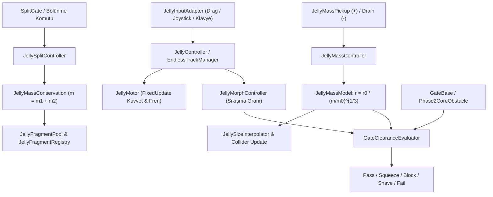

# Sistem Mimarisi ve Veri Akışı (L3 Storage)

> **Not:** Bu belge yalnızca mimari tasarım, fizik/kütle kuralları veya sistemler arası veri akışı incelenirken okunur. Mevcut `Docs/Architecture.md` ile uyumludur `[VERIFIED]`.

## 1. Mimari İlkeler
1. **Bileşen Tabanlı Ayrıştırma (Decoupled Components):** Fiziksel yuvarlanma (`JellyMotor`), kütle/hacim hesabı (`JellyMassModel`), geçit değerlendirmesi (`GateClearanceEvaluator`), parça korunumu (`JellyMassConservation`) ve görsel esneme (`JellyDeformationController` / `JellyRealtimeDeformer`) birbirinden bağımsız sınıflarda çalışır `[VERIFIED]`.
2. **Veri Odaklı Yapılandırma (Data-Driven):** Hareket (`JellyMovementConfig`), kütle (`JellyMassConfig`) ve 50 seviye tanımı (`JellyLevelDefinition`) `Assets/Jelly/Configs/` ve `Assets/Jelly/Levels/` altındaki `ScriptableObject` varlıklarında tutulur `[VERIFIED]`.
3. **Tekil Otorite (Single Source of Truth):**
   - Kütle ve yarıçap otoritesi: `JellyMassModel` (`Assets/Jelly/Runtime/JellyMassAndMorphSystem.cs`) `[VERIFIED]`.
   - Bölünmüş parça otoritesi: `JellyFragmentRegistry` (`Assets/Jelly/Runtime/JellyFragmentRegistry.cs`) `[VERIFIED]`.
4. **Fizik Bütünlüğü:** Tüm kuvvet ve torklar yalnızca `FixedUpdate` içinde uygulanır. Yüksek hızda duvar içinden geçmeyi (tunneling) ve kamera titremesini önlemek için `CollisionDetectionMode.ContinuousDynamic` ve `RigidbodyInterpolation.Interpolate` kullanılır `[VERIFIED]`.
5. **Sıfır GC / Mobil Havuzlama:** Bölünmüş jöle parçaları (`JellyFragmentPool`) ve efektler (`JellyFXPool`) çalışma zamanında bellek tahsisi yapmamak için nesne havuzu (object pool) kullanır `[VERIFIED]`.

---

## 2. Çekirdek Veri Akışı

---

## 3. İki Katmanlı Oyun Modu Mimarisi
Projede hem birim testlerle korunan **Modüler Seviye Mimarisi** hem de vitrin/sonsuz koşu odaklı **Showcase / Endless Mimarisi** birlikte bulunur:

### A. Modüler Seviye Sistemi (`Assets/Jelly/Scenes/Level_01..10.unity` & `LevelLoader`)
- `LevelManager` aktif `JellyLevelDefinition` varlığını `LevelLoader` aracılığıyla sahneye kurar `[VERIFIED]`.
- Oyuncu `LevelGoalZone` noktasına ulaştığında `LevelGoalEvaluator` kalan kütleyi, tek parça (`requireSingleMergedJellyAtGoal`) şartını ve yıldız kurallarını (`StarRatingRules`) denetler `[VERIFIED]`.
- Sonuç `SaveGameService` ile JSON olarak kalıcı hale getirilir `[VERIFIED]`.

### B. Vitrin & Sonsuz Koşu Sistemi (`Assets/Scenes/SampleScene.unity` & `EndlessTrackManager`)
- `EndlessTrackManager` 15 seviyeli müfredatı (`JellyProgressiveMapGenerator`) ve 8 farklı pist segmentini (`TrackSegmentModuleType`) dinamik olarak oluşturur `[VERIFIED]`.
- `BlenderKitModelSpawner` prosedürel 3B modelleri (piston kapılar, cam duvarlar, döner kollar, yarı saydam `+/-` küreler) üretir `[VERIFIED]`.
- `JellyRealtimeDeformer` jölenin hız, zıplama ve çarpışma anlarındaki organik esnemesini hesaplar `[VERIFIED]`.
