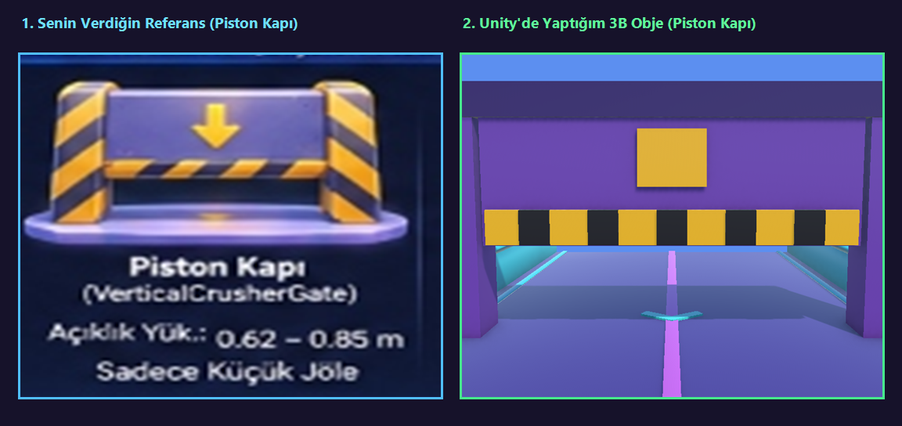
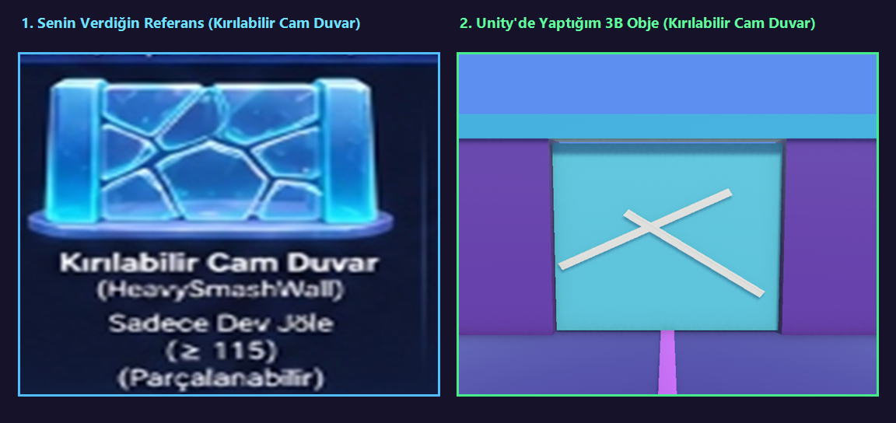
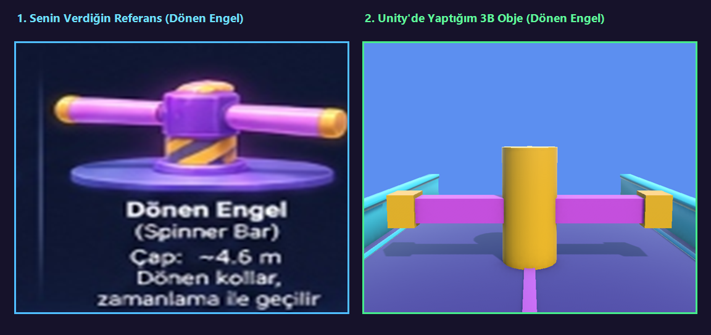
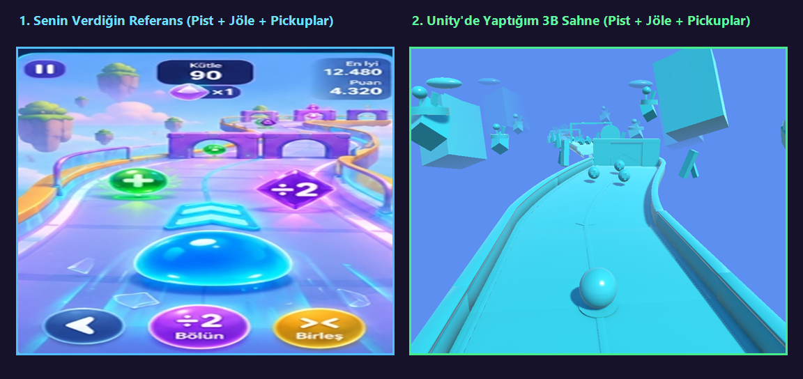

# Project Jelly — 3D Hyper-Casual Endless Morph & Split Runner

**Project Jelly**, Unity 6 (URP) ile geliştirilmiş, dinamik morfoloji (büyüme/küçülme), ikiz parçalara bölünme (`÷2`), birleşme (`><`) ve 8 farklı pist mimarisine sahip 3B hiper-gündelik koşu oyunudur.

🎮 **Canlı Web Vitrini (Vercel):** [https://project-jelly.vercel.app](https://project-jelly.vercel.app)

---

## 📸 Referans & Karşılaştırma

| Referans Tasarım | Unity 3B Üretim |
|---|---|
|  | Piston Kapı (Sarı-siyah ikaz şeridi, ↓ ok, hidrolik) |
|  | Kırılabilir Cam Duvar (Çatlak kristal, parçalanma) |
|  | Dönen Engel (360° döner kollar, zamanlama kaçışı) |
|  | Spline Yol, Jöle Morfolojisi, Yüzen Adalar |

---

## 🌟 Öne Çıkan Özellikler

- **Dinamik Jöle Fiziği & Morfoloji:**
  - Küçük Jöle (≤ 75): Ø 0.62 – 0.85 m
  - Normal Jöle (76 – 114): Ø ~1.0 m
  - Dev Jöle (≥ 115): Ø 1.16 – 1.65 m (Zümrüt Yeşili ışıma)
- **Bölünme (÷2) & Birleşme (><):**
  - İkiz tüneller ve ikiye ayrılan köprülerde jöle iki bağımsız %50 kütleye ayrılır.
  - Engellerden sonra otomatik veya ergonomik butonlarla birleşir.
- **9 Toplanabilir Nesne (Pickups):**
  - `Büyüme Küresi (+)`
  - `Küçülme Küresi (-)`
  - `Bölünme Kristali (÷2)`
  - `Birleşme Halkası (><)`
  - `Süper Hız Bandı (⚡)`
  - `Kalkan (🛡)`
  - `Mıknatıs (🧲)`
  - `Puan Yıldızı (⭐ +500)`
  - `Yavaş Zaman (⏳)`
- **5 Biyom & Tema:**
  - Jöle Diyarı (Ana Tema)
  - Şeker Ülkesi (Candy)
  - Buz Kristal (Ice)
  - Volkanik Jel (Lava-Jelly)
  - Uzay Jel (Neon/Galaksi)
- **8 Farklı Pist Segment Mimarisi:**
  1. *StandardRoad:* Kıvrımlı ana yol ve engeller.
  2. *SplitTwinBridge:* Ortası açık derin uçurum ve çift köprü.
  3. *JumpRampOverAbyss:* Zıplama rampası ve havada altın halka.
  4. *DoubleDeckerOverpass:* 2. kat viyadük ve kırılabilir cam zemin.
  5. *LaserSlicerGate:* Mavi dikey dilimleyici & Kırmızı yatay tıraşlayıcı.
  6. *SurfaceHazardZone:* Kaygan buz ve toksik jöle emici zeminler.
  7. *ColorMatchSection:* 3 renkli boya havuzları ve eşleşen bariyerler.
  8. *LevelFinaleMultiplier:* x2, x3, x5 ve x10 bonus çarpan duvarları.
- **6 Farklı Ekran Arayüzü (UI/UX):**
  - Ana Menü, Oyun İçi HUD, Seviye Tamamlama / Oyun Bitti, Görevler, 3 Sekmeli Mağaza, Ayarlar.

---

## 🛠️ Kurulum & Çalıştırma (Unity Editor)

1. **Unity Version:** `Unity 6000.5.6f1` (veya üzeri Unity 6 sürümü).
2. Unity Hub üzerinden projeyi açın (`c:\Users\ASUS\.gemini\antigravity\scratch\JellyShift`).
3. Üst menüden `Jelly -> Generate All Project Assets & Scenes` seçeneğine tıklayın.
4. `Assets/Scenes/SampleScene.unity` sahnesini açıp **Play** butonuna basın.

---

## 📁 Proje Dizin Yapısı

```
Assets/
└── Jelly/
    ├── Configs/         # ScriptableObject ayarları (hareket, kütle)
    ├── Editor/          # Otomatik sahne ve asset üreticileri
    ├── Levels/          # Seviye tanımları (50 adet ScriptableObject)
    ├── Materials/       # Stylized jöle ve pist materyalleri
    ├── Prefabs/         # Karakter, geçit ve pickup prefabları
    ├── Runtime/         # Çekirdek C# oyun sistemleri
    └── Scenes/          # Tüm bölümler ve test sandkutusunun sahneleri
Docs/                    # Mimari ve test raporları
images/                  # Vitrin ve karşılaştırma ekran görüntüleri
```

---

*Geliştirici:* **Centan2025**  
*Lisans:* MIT
